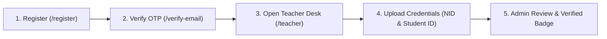
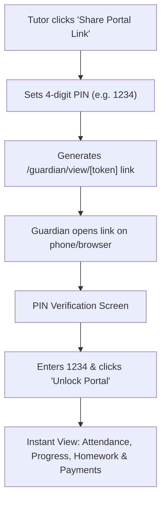

# 🎓 TutorHub — Operations & Memory Platform for Private Tutors

> **High-Performance Operations & Transparency Platform for Private Tutors and Guardians in Bangladesh.**  
> Built with Next.js 16 (Turbopack), Express 5, TypeScript, MongoDB, and Tailwind CSS.

[](file:///d:/Antigravity_Work/TutorHub/backend)
[-black?style=flat-square&logo=next.js)](file:///d:/Antigravity_Work/TutorHub/frontend)
[](file:///d:/Antigravity_Work/TutorHub)
[](file:///d:/Antigravity_Work/TutorHub/frontend)
[](file:///d:/Antigravity_Work/TutorHub/backend)

---

## 📑 Table of Contents
1. [Core Features Overview](#-core-features-overview)
2. [Complete Frontend Routes & UI Flow Guide](#-complete-frontend-routes--ui-flow-guide)
3. [Complete Backend API Endpoints Matrix](#-complete-backend-api-endpoints-matrix)
4. [User Journeys & Step-by-Step Usage Flows](#-user-journeys--step-by-step-usage-flows)
   - [A. Teacher Setup & Verification](#a-teacher-setup--verification-flow)
   - [B. Tuition Contract Creation (Weekly / Monthly & Multi-Student)](#b-tuition-contract-creation-flow)
   - [C. Daily Class Session Logging & Next-Day Memory](#c-daily-class-session-logging--next-day-memory-flow)
   - [D. Guardian Direct Share Link & PIN Verification](#d-guardian-direct-share-link--pin-verification-flow)
   - [E. Marketplace Tuition Board & Applications](#e-marketplace-tuition-board--applications-flow)
   - [F. Admin Command & Verification Center](#f-admin-command--verification-center-flow)
5. [Architecture & Decoupling](#-architecture--decoupling)
6. [Local Development Setup](#-local-development-setup)
7. [Production Deployment & Vercel Configuration](#-production-deployment--vercel-configuration)
8. [Testing Matrix](#-testing-matrix)

---

## 🚀 Core Features Overview

### 1. Tuition Engine & Flexible Cycle Models
- **Weekly Cycle (`FIXED_WEEKLY`)**: Choose specific class days of the week (`Sat`, `Sun`, `Mon`, `Tue`, `Wed`, `Thu`, `Fri`). Billing cycles automatically calculate based on chosen frequency (e.g. 3 days/week = 12 classes/cycle).
- **Monthly Cycle (`MONTHLY_CYCLE`)**: Choose target number of classes per month/cycle (e.g. 8, 10, 12, 16, 20, 24, 30 days) with quick preset selectors.
- **Multiple Students in Same Agreement**: Add multiple students (siblings or small batches) with individual names, classes (same class or different classes, e.g. Class 8 and Class 10), and custom subjects.

### 2. "Next-Day Memory" Session Logger
- Automatically pulls the last unfinished topics, assigned homework, and upcoming lesson plans into today's session log modal as soon as the tutor opens it.
- Multi-student attendance tracking (`Present`, `Absent`, `Late`) per student in a shared tuition session.
- Idempotency via `clientRequestId` preventing accidental double-counting on network retries.

### 3. PIN-Protected Guardian Transparency Viewer (`/guardian/view/[token]`)
- One-click shareable link for guardians with 4-digit PIN protection.
- **Zero Login Required**: Guardians don't need to register or remember credentials to view their child's progress.
- Brute-force protection: 15-minute lockout after 5 consecutive failed attempts.
- Real-time sanitized view of student attendance, covered topics, tutor remarks, and payment status.
- Strict Privacy: Private phone numbers, email addresses, and internal tutor notes are never exposed.

### 4. Dual-Sided Marketplace & Mutual Contact Unlocking
- Guardians post tuition requirements with subjects, grade, preferred schedule, budget, and teaching mode (in-person, online, hybrid).
- Verified tutors apply with tailored pitch notes.
- Upon guardian acceptance, mutual `ContactGrant` records unlock verified phone and WhatsApp contacts for direct coordination.

### 5. Multi-Tutor Claimed Guardian Portal (`/guardian`)
- Single dashboard for parents to track multiple children and tutors under one claimed account.
- Direct contact request tracker and active tuition board postings.
- Auto-redirect: If a guardian opens `/guardian?token=xyz`, it automatically forwards them to the PIN verification screen at `/guardian/view/xyz`.

### 6. Admin Command Center (`/admin`)
- Platform KPI metrics (teachers, verified ratio, contracts, open requirements).
- Teacher document verification queue: inspect National ID / Student ID uploads with one-click **Approve** or **Reject** (with feedback notes).
- Tuition audits, system maintenance toggles, and GDPR data export/anonymization.

---

## 🗺️ Complete Frontend Routes & UI Flow Guide

| Route | Access | What's There & Purpose | Key Actions |
|---|---|---|---|
| `/` | Public | **Platform Homepage**: Value proposition, interactive product overview, comparison matrix, feature highlights, and FAQs. | Navigate to Directory, Marketplace, Login, or Register. |
| `/login` | Public / Guest | **Unified Login**: Sign in using Email or Phone Number with password. Detects unverified accounts and redirects to OTP verification. | Log in, toggle password visibility, navigate to Forgot Password or Register. |
| `/register` | Public / Guest | **Registration**: Role toggle (`I am a Tutor` vs `Guardian`). Captures Full Name, Email, Bangladeshi Mobile Number (`017XXXXXXXX`), and Password. | Creates account, generates 6-digit OTP, redirects to `/verify-email`. |
| `/verify-email` | Public | **6-Digit OTP Verification**: Clean digit-box input (`OtpInput`) with paste support, auto-advance, and 60-second resend cooldown. | Verify email, optionally set/update password in-place, resend code. |
| `/forgot-password` | Public | **Password Reset Request**: Submit registered email address to receive password reset link. | Sends reset link, returns to login. |
| `/reset-password` | Public | **Password Reset Screen**: Accepts `?token=...` from email, validates new password match, and updates password. | Sets new password, redirects to `/login`. |
| `/claim-guardian` | Public / Invited | **Shadow Guardian Claim Flow**: Two-step flow via `?token=...` sent by tutor invite. Step 1: verify claim token & request OTP. Step 2: verify OTP and set password to claim account. | Activates guardian account, links shadow tuitions to account. |
| `/teacher` | `TEACHER` role | **Teacher Control Plane**: Core dashboard showing active tuitions, cycle progress bars, quick session logger, payment recorder, and profile manager. | Create tuition, log class session, record payment, generate PIN share link, manage profile. |
| `/teachers` | Public | **Public Teacher Directory**: Search tutors by name, university (DU, BUET, NSU, etc.), subjects, or Dhaka areas. Filter by verified status and rate range. | Browse tutors, view tutor cards, open detailed public profile. |
| `/teachers/[slug]` | Public | **Tutor Public Profile**: SEO-optimized tutor profile displaying verified badges, education, experience, offered subjects, areas, and rate range. | Click **"Request Contact Info"** to submit a requirement note to the tutor. |
| `/guardian` | `GUARDIAN` role | **Claimed Guardian Dashboard**: View linked active tuitions across multiple tutors, view contact access requests, and manage posted tuition requirements. Auto-redirects to `/guardian/view/[token]` if query `?token=` is passed. | View contracts, manage contact requests, post new requirements. |
| `/guardian/view/[token]` | Public (Direct Link) | **Guardian Transparency Portal**: Direct view screen protected by 4-digit PIN. Displays student classes, attendance, topics taught, homework, next-day memory, and payments with zero login required. | Enter 4-digit PIN to unlock, view real-time class tracking logs. |
| `/marketplace` | Public | **Tuition Board (Marketplace)**: Live listing of guardian tuition requirements. Filter by area, subject, curriculum, mode, and budget. | Tutors apply to requirements with customized pitch notes. |
| `/marketplace/create` | `GUARDIAN` role | **Post Tuition Requirement**: Form for guardians to post requirements (Class, Curriculum, Subjects, Location, Schedule type, Budget, Gender preference). | Submit requirement post to the tuition board. |
| `/admin` | `ADMIN` role | **Admin Command Center**: Platform KPIs, Teacher Credential Verification Queue, Tuition Contract Audits, Maintenance Mode toggle, and Audit Logs. | Review verification documents, approve/reject tutors, audit system. |
| `/profile` | Authenticated | **User Profile Redirection**: Redirects user to their respective dashboard (`/teacher`, `/guardian`, or `/admin`). | Route resolution. |

---

## 📡 Complete Backend API Endpoints Matrix

All API endpoints are prefixed with `/api/v1` (configurable via `API_PREFIX`).

### 1. Authentication & Account Management (`/api/v1/auth`)

| Method | Endpoint | Access | Body Payload / Parameters | Response / Purpose |
|---|---|---|---|---|
| `POST` | `/auth/register` | Public | `{ name, email, phone, password, role: "TEACHER" \| "GUARDIAN" }` | Registers user with `PENDING_VERIFICATION` status, sends 6-digit OTP to email. |
| `POST` | `/auth/verify-email` | Public | `{ email, otp, newPassword? }` | Verifies OTP (max 5 attempts), activates user, sets session cookies (`th_access_token`, `th_refresh_token`). |
| `POST` | `/auth/resend-otp` | Public | `{ email }` | Generates fresh 6-digit OTP (60s cooldown) and dispatches email. |
| `POST` | `/auth/login` | Public | `{ identifier, password }` | Authenticates via email or phone, checks Argon2 hash, handles unverified status, sets auth cookies. |
| `POST` | `/auth/refresh` | Public | Cookie: `th_refresh_token` | Rotates refresh token with family reuse theft detection. Issues fresh access token. |
| `POST` | `/auth/logout` | Public | None | Clears auth cookies and marks session revoked. |
| `POST` | `/auth/logout-all` | Auth | None | Bumps `tokenVersion`, revoking all active sessions across all devices. |
| `POST` | `/auth/forgot-password` | Public | `{ email }` | Generates secure token, emails password reset link (valid 1 hour). |
| `POST` | `/auth/reset-password` | Public | `{ token, newPassword }` | Validates reset token, updates password, revokes existing sessions. |
| `POST` | `/auth/change-password` | Auth | `{ currentPassword, newPassword }` | Changes password for logged-in user, revokes other sessions. |
| `GET` | `/auth/me` | Auth | None | Returns currently authenticated user profile and roles. |
| `POST` | `/auth/claim-guardian/start` | Public | `{ claimToken }` | Initiates shadow guardian account claim, sends OTP to guardian's email. |
| `POST` | `/auth/claim-guardian/verify` | Public | `{ claimToken, otp, password }` | Verifies OTP, sets password, activates guardian account, links shadow tuitions. |
| `GET` | `/auth/export-data` | Auth | None | GDPR self-service: exports full JSON dump of user profile, tuitions, sessions, and posts. |
| `POST` | `/auth/delete-account` | Auth | `{ password }` | Irreversibly anonymizes user profile, archives active tuitions, suspends account. |

---

### 2. Tuition Management (`/api/v1/tuitions`)

| Method | Endpoint | Access | Body Payload / Parameters | Response / Purpose |
|---|---|---|---|---|
| `POST` | `/tuitions` | `TEACHER` | `{ title?, students: [{ name, classGrade, curriculum?, subjects[] }], scheduleConfig: { billingModel, targetDaysPerCycle, weeklyDays[], durationMinutes? }, monthlyFee, guardianName?, guardianPhone, guardianEmail? }` | Creates tuition agreement. Supports **Weekly Cycle** (`FIXED_WEEKLY`) and **Monthly Cycle** (`MONTHLY_CYCLE`), single or multiple students (same or different classes), initializes Cycle 1. |
| `GET` | `/tuitions` | `TEACHER` | None | Returns list of all tuition contracts owned by the tutor. |
| `GET` | `/tuitions/:id` | `TEACHER` | Param: `id` | Returns single tuition contract with students, schedule, current cycle, and payment history. |
| `PATCH` | `/tuitions/:id` | `TEACHER` | `{ title?, status?, students?, scheduleConfig?, monthlyFee?, guardianName?, guardianPhone? }` | Updates tuition contract settings. |
| `POST` | `/tuitions/:id/sessions` | `TEACHER` | `{ clientRequestId, sessionDate, sessionLocalDate, durationMinutes, sessionType, entries: [{ studentId, attendance, subject, topicsTaught?, homeworkAssigned?, previousHomeworkStatus? }], guardianVisibleRemarks? }` | Logs class session with Next-Day memory entries. Increments `completedDays`, checks cycle completion. |
| `GET` | `/tuitions/:id/sessions` | `TEACHER` | Param: `id` | Returns paginated list of session logs for the tuition. |
| `GET` | `/tuitions/:id/sessions/prefill` | `TEACHER` | Param: `id` | Retrieves "Next-Day Memory Prefill" from latest session (unfinished topics, assigned homework, next plan). |
| `POST` | `/tuitions/:id/payments` | `TEACHER` | `{ amount, method: "CASH" \| "BKASH" \| "NAGAD" \| "BANK", reference?, note?, advanceToNextCycle? }` | Records tuition payment, updates `amountPaid` and `paymentStatus` (`PAID` / `PARTIAL`). Optionally rolls over to next cycle. |
| `POST` | `/tuitions/:id/share-token` | `TEACHER` | `{ accessPin: "1234" }` | Generates secure direct transparency share link (`/guardian/view/[token]`) with 4-to-6 digit PIN protection. |
| `POST` | `/tuitions/:id/invite-guardian` | `TEACHER` | `{ guardianEmail }` | Generates a 14-day claim invite token and emails the guardian an account activation link. |
| `POST` | `/tuitions/:id/archive` | `TEACHER` | Param: `id` | Sets tuition status to `ARCHIVED`. |

---

### 3. Guardian Transparency & Portal (`/api/v1/guardian`)

| Method | Endpoint | Access | Body Payload / Parameters | Response / Purpose |
|---|---|---|---|---|
| `GET` | `/guardian/view/:token` | Public | None | Returns sanitized tuition tracking data if unlocked or indicates `requiresPin: true`. |
| `POST` | `/guardian/view/:token/verify-pin` | Public | `{ pin: "1234" }` | Verifies 4-digit PIN against Argon2 hash. Unlocks session on cookie for 24 hours. Rate limited (5 attempts = 15m lockout). |
| `GET` | `/guardian/tuitions` | `GUARDIAN` | None | Returns list of all linked tuition contracts for the authenticated guardian. |

---

### 4. Teacher Directory & Public Profiles (`/api/v1/teachers`)

| Method | Endpoint | Access | Query / Body Payload | Response / Purpose |
|---|---|---|---|---|
| `GET` | `/teachers` | Public | Query: `search`, `area`, `subject`, `minRate`, `maxRate`, `isVerified`, `page`, `limit` | Paginated public search directory of verified and active tutors. |
| `GET` | `/teachers/:slug` | Public | Param: `slug` | Public profile for a specific tutor (name, institution, subjects, bio, experience, rate range). |
| `GET` | `/teachers/profile/private` | `TEACHER` | None | Retrieves private profile of logged-in tutor (verification docs, address, WhatsApp number). |
| `PATCH` | `/teachers/profile/private` | `TEACHER` | `{ isPublic?, institution?, department?, batchOrYear?, experienceYears?, bio?, subjectsOffered?, preferredAreas?, expectedRateRange?, whatsappNumber?, address? }` | Updates tutor public profile and private details. |
| `POST` | `/teachers/profile/submit-verification` | `TEACHER` | None | Submits uploaded credentials for Admin review, moving status to `PENDING`. |

---

### 5. Contact Access Requests (`/api/v1/contact-requests`)

| Method | Endpoint | Access | Body Payload / Query | Response / Purpose |
|---|---|---|---|---|
| `POST` | `/contact-requests` | `GUARDIAN` | `{ teacherId, message, studentClassGrade?, subjects? }` | Guardian submits a contact request to view tutor's phone/WhatsApp. |
| `GET` | `/contact-requests/mine` | `GUARDIAN` | None | Returns guardian's submitted requests and approved contact grants. |
| `GET` | `/contact-requests/incoming` | `TEACHER` | None | Returns pending contact requests received by the tutor. |
| `POST` | `/contact-requests/:id/respond` | `TEACHER` | `{ action: "APPROVE" \| "REJECT", rejectionReason? }` | Tutor approves or rejects contact request. Approval creates mutual `ContactGrant`. |

---

### 6. Marketplace Tuition Board (`/api/v1/marketplace`)

| Method | Endpoint | Access | Query / Body Payload | Response / Purpose |
|---|---|---|---|---|
| `GET` | `/marketplace/posts` | Public | Query: `search`, `area`, `subject`, `mode`, `minBudget`, `maxBudget`, `page`, `limit` | Publicly browses active tuition requirements. |
| `GET` | `/marketplace/posts/:id` | Public | Param: `id` | Single requirement post details. |
| `POST` | `/marketplace/posts` | `GUARDIAN` | `{ title, description, studentsInfo: [{ classGrade, curriculum?, subjects[] }], location: { area, city, mode }, daysPerWeek?, targetDaysPerMonth?, budgetAmount, genderPreference? }` | Guardian posts new tuition requirement on the board. |
| `GET` | `/marketplace/my-posts` | `GUARDIAN` | None | Guardian views their own posted requirements and application counts. |
| `PATCH` | `/marketplace/posts/:id/close` | `GUARDIAN` | Param: `id` | Closes requirement post from new applications. |
| `POST` | `/marketplace/posts/:id/apply` | `TEACHER` | `{ pitchNote, proposedRate? }` | Tutor applies to a posted tuition requirement. |
| `GET` | `/marketplace/my-applications` | `TEACHER` | None | Tutor views their submitted applications and status (`PENDING`, `ACCEPTED`, `REJECTED`). |
| `GET` | `/marketplace/posts/:id/applications`| `GUARDIAN` | Param: `id` | Guardian views applicants for their requirement post. |
| `POST` | `/marketplace/applications/:id/respond`| `GUARDIAN` | `{ action: "ACCEPT" \| "REJECT" }` | Guardian accepts or rejects tutor application. Acceptance generates mutual `ContactGrant`. |

---

### 7. Document Uploads (`/api/v1/uploads`)

| Method | Endpoint | Access | Form Data Payload | Response / Purpose |
|---|---|---|---|---|
| `POST` | `/uploads/document` | `TEACHER` | `multipart/form-data`: `file` (image/pdf, max 3MB), `docType: "NID" \| "STUDENT_ID" \| "CERTIFICATE"` | Uploads credential document to Cloudinary and saves reference in `TeacherPrivateProfile`. |

---

### 8. Admin Command Center (`/api/v1/admin`)

| Method | Endpoint | Access | Query / Body Payload | Response / Purpose |
|---|---|---|---|---|
| `GET` | `/admin/stats` | `ADMIN` | None | High-level analytics: total teachers, verified ratio, active contracts, total sessions. |
| `GET` | `/admin/verifications` | `ADMIN` | None | Queue of teachers pending document verification with uploaded credentials. |
| `POST` | `/admin/verifications/:teacherId/respond` | `ADMIN` | `{ action: "APPROVE" \| "REJECT", feedback? }` | Approves or rejects teacher verification badge. |
| `GET` | `/admin/tuitions` | `ADMIN` | None | Platform-wide audit list of all tuition contracts and cycle statuses. |
| `GET` | `/admin/config` | `ADMIN` | None | Retrieves system configuration (maintenance mode, rate limits). |
| `PATCH` | `/admin/config` | `ADMIN` | `{ maintenanceMode?, maxGuardianRequestsPerDay? }` | Updates global system configuration. |
| `GET` | `/admin/audit-logs` | `ADMIN` | Query: `page`, `limit`, `action` | Paginated system security and audit trail. |

---

## 🧭 User Journeys & Step-by-Step Usage Flows

### A. Teacher Setup & Verification Flow

1. Visit **`/register`**, toggle **"I am a Tutor"**, fill in name, email, Bangladeshi mobile (`017XXXXXXXX`), and password.
2. Enter the 6-digit verification code received in email on **`/verify-email`**.
3. Open the **Teacher Desk (`/teacher`)** and click **"My Profile"**.
4. In the **Verification Docs** tab, drag and drop your **National ID / Birth Certificate** and **University Student ID** (max 3 MB each).
5. Click **"Submit for Verification"**. The admin team reviews and awards the **Verified Tutor** badge.

---

### B. Tuition Contract Creation Flow
1. In the **Teacher Dashboard (`/teacher`)**, click **"Create New Tuition"**.
2. **Add Students (Single or Multiple)**:
   - Enter Student Full Name, Class / Grade (e.g. `Class 9`, `HSC`, `Class 7`), and Subjects.
   - For siblings or small batches, click **"+ Add Student"** to add another student from the **same or a different class**.
3. **Choose Schedule Model**:
   - **Weekly Cycle**: Click `Weekly Cycle`, select the class days (e.g. `Sun`, `Tue`, `Thu`). The cycle target auto-calculates (e.g. 3 days/week = 12 classes/cycle).
   - **Monthly Cycle**: Click `Monthly Cycle`, select or type target classes per cycle (e.g. `8d`, `12d`, `16d`, `24d`).
4. Set the **Monthly Fee (BDT)** and enter the **Guardian's Name & Phone Number**.
5. Click **"Save & Launch Cycle"**. Cycle 1 is initialized with 0 completed days.

---

### C. Daily Class Session Logging & Next-Day Memory Flow
1. On any active tuition card, click **"Log Daily Session"**.
2. **Next-Day Memory Banner**: The modal automatically pre-fills with the unfinished topics and assigned homework from the previous class.
3. **Multi-Student Attendance**: If the contract has multiple students, toggle attendance status (`Present`, `Absent`, `Late`) for each student individually.
4. Input topics covered today, unfinished topics, new homework, and optional guardian remarks.
5. Click **"Save & Advance Cycle"**. The cycle day counter increments automatically.

---

### D. Guardian Direct Share Link & PIN Verification Flow

1. **Tutor Generates Link**:
   - On the tuition card, click **"Share Portal Link"**.
   - Set a 4-digit PIN (e.g., `1234`) and click **"Generate Share Link"**.
   - Copy the link or click **"Share via WhatsApp"**. The generated link points to:
     ```
     https://<your-domain>/guardian/view/<token>
     ```
2. **Guardian Opens Link**:
   - The guardian opens the link on any browser (no login required).
   - They see the **Guardian PIN Verification** screen.
   - They enter the 4-digit PIN provided by the tutor and click **"Unlock Portal"**.
3. **Transparency Dashboard Unlocks**:
   - Guardian views real-time progress: completed classes, upcoming schedule, daily topics, homework, tutor remarks, and payments.

---

### E. Marketplace Tuition Board & Applications Flow
1. **Guardian Posts**: Guardian goes to **`/marketplace/create`**, fills in student class, curriculum, subjects, location, days, budget, and submits.
2. **Tutor Browses**: Tutors browse **`/marketplace`** with filters (Dhanmondi, Uttara, Class 10, English Medium, etc.).
3. **Tutor Applies**: Tutor clicks **"Apply"** and submits their pitch and proposed rate.
4. **Guardian Accepts**: Guardian views applicants in **`/guardian`**, reviews tutor profiles, and clicks **"Accept Tutor"**.
5. **Mutual Contact Unlocked**: Both parties instantly receive mutual `ContactGrant`s revealing direct mobile and WhatsApp numbers.

---

### F. Admin Command & Verification Center Flow
1. Admin logs in with administrative credentials and visits **`/admin`**.
2. **Verification Queue**: Review submitted tutor student IDs and National IDs.
3. Click **"Approve"** to grant verified status, or **"Reject"** with custom feedback.
4. **Tuition Audits**: Inspect live contract progress, payment statuses, and platform health.
5. **System Controls**: Toggle platform-wide maintenance mode or configure daily guardian request limits.

---

## 🏗️ Architecture & Decoupling

TutorHub is designed as two standalone, decoupled services:

```
TutorHub/
├── backend/                      # Express 5 & Mongoose API
│   ├── api/index.ts              # Vercel serverless entry point
│   ├── vercel.json               # Serverless rewrites configuration
│   └── src/
│       ├── config/               # DB connection pooling, CORS, Env
│       ├── controllers/          # Route handlers
│       ├── dtos/                 # Privacy-safe Data Transfer Objects
│       ├── middlewares/          # Auth, CSRF, Rate limit, Validation
│       ├── models/               # Mongoose schemas (Tuition, SessionLog, User, etc.)
│       ├── routes/               # Modular Express routers
│       ├── schemas/              # Zod validation schemas
│       ├── services/             # Core transactions & Email outbox
│       └── tests/                # Vitest test suites (60 tests)
│
├── frontend/                     # Next.js 16 (App Router + Turbopack)
│   ├── next.config.ts            # Reverse proxy rewrites & Security headers
│   ├── src/
│   │   ├── app/                  # App Router pages (/teacher, /guardian, /admin, etc.)
│   │   ├── components/           # Navbar, OtpInput, BottomNav, ThemeToggle
│   │   ├── context/              # AuthContext & Session management
│   │   └── lib/                  # Axios API client & error handler
│
└── README.md                     # Complete project documentation
```

---

## ⚡ Local Development Setup

### 1. Prerequisites
- **Node.js** v20 or higher
- **MongoDB** instance (local replica set or MongoDB Atlas)

### 2. Backend Setup
```bash
cd backend
npm install

# Configure environment
cp .env.example .env
# Edit .env with your MONGODB_URI and JWT secrets

# Run seed admin
npm run seed:admin

# Run test suite
npm test

# Start dev server (Port 5000)
npm run dev
```

### 3. Frontend Setup
```bash
cd ../frontend
npm install

# Configure environment
cp .env.example .env.local
# Set NEXT_PUBLIC_API_URL=http://localhost:5000/api/v1

# Start dev server (Port 3000)
npm run dev
```

Open **`http://localhost:3000`** in your browser.

---

## 🌐 Production Deployment & Vercel Configuration

### Backend Vercel Setup
1. In your **Vercel Backend Project Settings**, configure the following environment variables:

| Variable | Recommended Production Value | Description |
|---|---|---|
| `NODE_ENV` | `production` | Production environment flag |
| `API_PREFIX` | `/api/v1` | Base route prefix |
| `MONGODB_URI` | `mongodb+srv://...` | MongoDB Atlas replica set URI |
| `JWT_ACCESS_SECRET` | 32+ character string | Token signing secret |
| `JWT_REFRESH_SECRET` | 32+ character string | Refresh token signing secret |
| `COOKIE_SECRET` | 32+ character string | Cookie signing secret |
| `SMTP_HOST` | `smtp.gmail.com` | SMTP Server Host |
| `SMTP_PORT` | `465` | Direct SSL/TLS port |
| `SMTP_SECURE` | `true` | Direct TLS enabled |
| `SMTP_USER` | `your-email@gmail.com` | Gmail account |
| `SMTP_PASS` | `16-character-app-password` | Google App Password (without spaces) |
| `EMAIL_FROM` | `TutorHub <noreply@tutorhub.com>` | Sender address |
| `CORS_ORIGIN` | `https://your-frontend.vercel.app` | Frontend production origin |

### Frontend Vercel Setup
In your **Vercel Frontend Project Settings**, add:
```
BACKEND_INTERNAL_URL=https://<your-backend-project>.vercel.app
```
Next.js server-side rewrites will automatically proxy `/api/*` requests to your backend server-to-server, completely bypassing browser CORS restrictions.

---

## 🧪 Testing Matrix

Backend test suites are powered by **Vitest** with in-memory replica sets (`mongodb-memory-server`):

```bash
cd backend
npm test
```

### Verified Test Suites (60/60 Tests Passing):
- **`src/tests/auth.test.ts` (7 tests)**: Registration, email verification, login, refresh rotation, family theft detection, lockout after failed attempts.
- **`src/tests/tuition.test.ts` (10 tests)**: Single and multi-student tuitions (different and same classes), weekly vs monthly cycle creation, session logging with Next-Day memory, payment ledger, cycle rollover, and PIN share token generation.
- **`src/tests/phase3.test.ts` (11 tests)**: Public directory filters, PIN verification, 15-minute brute-force lockout, sanitized guardian viewer, contact access requests.
- **`src/tests/phase4.test.ts` (14 tests)**: Marketplace postings, tutor applications, mutual contact grants, admin KPIs, teacher verification queue, maintenance mode, and GDPR data export/deletion.
- **`src/tests/middleware.test.ts` (10 tests)**: Rate limiting, CSRF protection header check, Argon2id hashing, and RBAC role guards.
- **`src/tests/models.test.ts` (6 tests)**: Schema indexes, compound indexes, and sensitive field omission (`select: false`).
- **`src/tests/health.test.ts` (2 tests)**: Liveness (`/healthz`) and readiness (`/readyz`) probes.

---

## 📄 License
This project is licensed under the MIT License.
